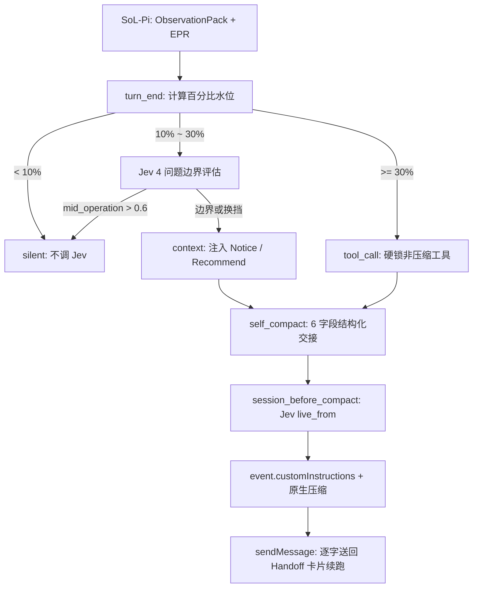

# Design

## Context

本设计实现 `specs/self-compact/spec.md` 中定义的 `self-compact` 扩展能力。
在 `pi-config` 现有体系中，`SoL-Pi`（`@nvlabs/sol-pi`）同时挂载了底层的观测减重组件（`actionFusion`、`observationPack`、`evidencePreservingReducer`）与顶层的在线压缩组件（`onlineContextCompact`）。如果直接引入自压缩扩展，`SoL-Pi` 的 `onlineContextCompact` 会在 `turn_end`、`agent_settled` 与 `session_before_compact` 钩子上围绕 `update_plan` 自动调用 `ctx.compact()`，与自压缩扩展产生竞争。

同时，我们对三份核心参考源码进行了深入对标：
- **Disler `self-compact`**（`/Volumes/Shuttle/projects/data/dan-repo/self-compact-pi-agent/apps/self-compact/extensions/self-compact/`）：提供了完整的四阶段交接状态机（`pending → compacting → ready → done`）、`recoverState()` 四断点崩溃恢复、单工具调用守卫（`tool_call`）与 `hasCompactionMaterial()` 下限检查；但其仅支持机械的水位线触发，且其 `summary.ts` 通过硬编码替换 `<conversation>` 字符串接管摘要生成，对 Pi 版本升级脆弱；此外其 `installFooter()` 调用 `ctx.ui.setFooter()` 会覆盖本仓全局启用的 `pi-powerline`。
- **Disler `ten-levels-of-jev` Level 7**（`/Volumes/Shuttle/projects/data/dan-repo/ten-levels-of-jev/apps/ten-levels/extensions/jev-compact.ts` 及 `src/levels/level07/`）：通过 TypeSafe Jev System One 模型在 ~300ms 内完成 4 问题语义边界门控（`switched_gears`、`at_boundary`、`needs_history`、`mid_operation`）与 `session_before_compact` 动态切割点选择（`live_from`），并通过 `event.customInstructions` 安全注入切割指令；但其缺少 `self-compact` 的强制锁死防线、崩溃恢复状态机和强结构化交接约束。
- **NVIDIA `SoL-Pi`**（`/Users/nantasmac/.pi/agent/git/github.com/NVlabs/SoL-Pi/src/sol-pi/extensions/`）：其 `observationPack` 将超大工具输出替换为 `obs_xxx` 句柄并提供 `obs_recall` 按需分页召回，`evidencePreservingReducer` 对超长测试/构建日志做保真缩减。

本设计将三者合流：**底层由 `SoL-Pi` 负责单条大观测减重，顶层由 `self-compact` 结合 Jev System One 负责水位监控、语义边界门控、动态切割点与 6 字段结构化交接（显式保留 `obs_xxx` 句柄）**。



## Goals / Non-Goals

**Goals:**
- 消除与 `SoL-Pi` `onlineContextCompact` 的生命周期冲突，保留 `SoL-Pi` 的 `obs_recall` 与 EPR 能力，并在结构化交接中原生保留 `obs_xxx` 句柄。
- 实现面向 1M 窗口模型的纯百分比三档默认水位线（`10%` Notice / `20%` Recommend / `30%` Forced），支持配置文件与 CLI flags 覆盖。
- 内置零外部依赖的 `JevClient`（支持 `TYPESAFE_API_KEY`、`OPENROUTER_API_KEY` 与测试 `mock`），仅在 `[soft, forced)` 区间且具备可压缩历史时于 `turn_end` 调用，在 `mid_operation` 期间保持静默不打扰主模型。
- 提供 `view_context` 与强类型 6 字段 `self_compact` 工具，确保交接卡片逐字保真返回并自动触发下一回合续跑。
- 在 `session_before_compact` 中通过 Jev 选择 `live_from` 切割点，并通过 `event.customInstructions` 注入结构化摘要要求与切割指令，不侵入 Pi 内部 `<conversation>` 字符串格式。
- 完整实现 `self-compact-state` 持久化状态机与 4 类崩溃/分支切换恢复，并通过 `ctx.ui.setStatus` 与 `pi-powerline` 无冲突共存。

**Non-Goals:**
- 不在 `< soft`（默认 `< 10%`）或 `>= forced`（默认 `>= 30%`）区间调用 Jev `turn_end` 边界判断。
- 不修改 `SoL-Pi` 包源码，也不替换 Pi 原生的 `generateSummary` 实现。
- 不使用 `ctx.ui.setFooter()` 劫持底栏。

## Decisions

### 1. 与 `SoL-Pi` 的分层解耦（对应 Requirement: Extension Self-Deduplication and Coexistence with SoL-Pi）

- **配置修改**：将 `.pi/managed/sol-pi.json` 中的 `"onlineContextCompact"` 改为 `false`：
  ```json
  {
    "actionFusion": true,
    "observationPack": true,
    "evidencePreservingReducer": true,
    "evidencePreservingReducerProvider": "zai-coding-cn",
    "evidencePreservingReducerModel": "glm-5.3",
    "onlineContextCompact": false,
    "cacheWriteReadRatio": 12.5
  }
  ```
- **扩展自去重守卫**：参照 `openspec/specs/extension-self-dedup/spec.md`，在 `.pi/extensions/self-compact/index.ts` 入口顶部检查进程级 Symbol：
  ```ts
  const DEDUP_KEY = Symbol.for("pi.self-compact.loaded");
  if ((globalThis as Record<symbol, unknown>)[DEDUP_KEY]) {
    return;
  }
  (globalThis as Record<symbol, unknown>)[DEDUP_KEY] = true;
  ```
  确保在 `pi-config` 工作区同时存在 `~/.pi/agent/extensions/self-compact/` 与 `.pi/extensions/self-compact/` 时只注册一次。

### 2. 目录结构与模块划分（`.pi/extensions/self-compact/`）

采用无外部运行时 npm 依赖的纯 TypeScript 目录型扩展（仅使用 Node.js 内置模块与 Pi 宿主提供的 `@earendil-works/pi-coding-agent`、`@earendil-works/pi-ai`、`@sinclair/typebox`）：

```text
.pi/extensions/self-compact/
├── index.ts           # 扩展入口、自去重守卫、CLI flags、工具/命令注册、生命周期钩子编排
├── thresholds.ts      # 配置文件读取、百分比/Token 规格解析、三档水位线与提取用量计算
├── jev-client.ts      # Jev System One HTTP 客户端（typesafe / openrouter / mock）
├── boundary-gate.ts   # turn_end 4 问题边界门控（evaluateBoundary）与 live_from 切割点选择（pickCutPoint）
├── handoff.ts         # 6 字段结构化交接校验、Handoff Markdown 卡片渲染、提示词模板渲染
├── state.ts           # self-compact-state 状态机、hasCompactionMaterial 检查、4 场景崩溃恢复
├── context-bar.ts     # 20 格进度条渲染与 /self-compact-info 详情格式化
└── test/
    └── self-compact.test.ts  # node --test 单元测试套件
```

### 3. 三档百分比水位线与分层配置（对应 Requirement: Three-Tier Percentage Watermark and Configuration Precedence）

- **托管配置文件 `.pi/managed/self-compact.json`**（通过 `.pi/capabilities.yaml` 的 `global.files` 同步至 `~/.pi/agent/self-compact.json`）：
  ```json
  {
    "softAt": "10%",
    "at": "20%",
    "buffer": "10%",
    "hardCeilingPercent": 90,
    "jev": {
      "enabled": true,
      "provider": "auto",
      "timeoutMs": 5000,
      "cutPointTimeoutMs": 8000,
      "minCutPointConfidence": 0.5
    }
  }
  ```
- **优先级顺序**：
  1. CLI flags：`--compact-soft-at`、`--compact-at`、`--compact-buffer`、`--compact-prompt`
  2. 项目级覆盖：`<cwd>/.pi/self-compact.json`
  3. 全局托管配置：`~/.pi/agent/self-compact.json`（回退读取仓库内 `.pi/managed/self-compact.json`）
  4. 代码内置默认值（`softAt: "10%"`, `at: "20%"`, `buffer: "10%"`）
- **计算规则（`thresholds.ts`）**：
  - 支持百分比字符串（如 `"10%"`）与绝对 Token 字符串（如 `"100k"`、`"100000"`）。
  - `soft = parseSpec(softAt, contextWindow)`
  - `warning = parseSpec(at, contextWindow)`
  - `forced = Math.min(warning + parseSpec(buffer, contextWindow), Math.floor(contextWindow * 0.90))`
  - 校验 `0 < soft <= warning < forced <= contextWindow`。
  - **可压缩材料下限（`hasCompactionMaterial`）**：复用 `@earendil-works/pi-coding-agent` 的 `estimateTokens`、`findCutPoint` 与 `SettingsManager.create(cwd).getCompactionKeepRecentTokens()`（默认 `20,000` tokens），确认上次压缩之后、保留切点之前确实存在可归档消息，避免在极小窗口或刚压缩完时误触发。

### 4. Jev System One 客户端与双阶段决策模型（对应 Requirement: Native Jev System One Semantic Boundary Gating & Dynamic Cut-Point Selection）

- **`JevClient`（`jev-client.ts`）**：
  - `provider: "auto"` 解析逻辑：
    1. 若 `process.env.TYPESAFE_API_KEY` 非空 → 使用 `typesafe`（URL: `https://api.typesafe.ai/v1/systemone`，model: `jev-latest`）
    2. 否则若 `process.env.OPENROUTER_API_KEY` 非空 → 使用 `openrouter`（URL: `https://openrouter.ai/api/alpha/decisions`，model: `~typesafe/jev-latest`）
    3. 否则标记为 `unavailable`（自动回退至纯百分比水位线逻辑，不抛致命异常）。
  - 支持注入 `mock` responder 函数以便单元测试确定性验证所有分支。
  - 超时控制：使用 `AbortSignal.timeout(timeoutMs)`；`turn_end` 边界判断默认 `5,000ms`（最多重试 1 次），`session_before_compact` 切割点选择默认 `8,000ms`。

- **阶段一：`turn_end` 4 问题边界评估（`boundary-gate.ts -> evaluateBoundary`）**：
  - **预筛门控**：仅当 `!state.locked && !compactionInFlight && hasCompactionMaterial && usedTokens >= thresholds.soft && usedTokens < thresholds.forced` 且（用户请求数 >= 2 或本轮执行了工具）时调用。
  - **输入状态 `CompactBoundaryState`**：
    - `current_request`: 最新一条用户消息文本（截断至 600 chars）
    - `previous_work`: 上次压缩后、当前用户请求之前的最近 6 条对话摘要（每条截断至 220 chars）
    - `recent_turn`: 当前请求之后的最新 4 条助手/工具消息摘要
    - `tools_this_turn`: 本轮调用的工具名列表（如 `"edit, bash"` 或 `"none"`）
  - **4 个 Typed Questions**：
    1. `switched_gears` (`type: "noul"`): `"Has the user's current request moved on to a different topic or task from the previous work?"`
    2. `at_boundary` (`type: "noul"`): `"Did the assistant just finish a self-contained unit of work — such as passing tests, completing an edit/commit, or delivering a complete answer?"`
    3. `needs_history` (`type: "score"`, `scale: ["low", "medium", "high"]`): `"How much does the next likely step depend on exact details (line numbers, stack traces, intermediate diffs) from earlier turns?"`
    4. `mid_operation` (`type: "noul"`): `"Is the assistant in the middle of an unfinished multi-step operation — such as investigating a failure, half-way through file edits, or waiting to verify a change?"`
  - **决策真值表（在代码中确定性执行）**：
    - 记 `pSwitch = prob(switched_gears, "yes")`，`pBoundary = prob(at_boundary, "yes")`，`pMidOp = prob(mid_operation, "yes")`，`historyLevel = argmax(needs_history)`。
    - 若 `pMidOp > 0.6` → `{ shouldCompact: false, tier: "silent", reason: "mid-operation (p=" + pMidOp + ")" }`
    - 否则若 `pSwitch > 0.6` 或 (`pBoundary > 0.6 && historyLevel !== "high"`)：
      - 若 `usedTokens >= thresholds.warning` → `{ shouldCompact: true, tier: "recommend", reason: ... }`
      - 若 `usedTokens >= thresholds.soft` 且当前 `cycle` 尚未发送过 Notice → `{ shouldCompact: true, tier: "notice", reason: ... }`
      - 否则 → `{ shouldCompact: false, tier: "silent", reason: "already noticed in current cycle" }`
    - 否则（既未换挡也未处于干净边界）：
      - 保持 `{ shouldCompact: false, tier: "silent", reason: "work still active / history needed" }`（直到触及 `forced` 硬线）。

- **阶段二：`session_before_compact` 动态切割点选择（`boundary-gate.ts -> pickCutPoint`）**：
  - 遵循 `typesafe-ai` 技能规范（使用 companion `noul` 配合 `choice`，不塞 `"none"` 伪选项）：
  - 提取上次压缩以来的用户回合列表 `turns: TurnSummary[]`（`turn_1` .. `turn_N`，包含 `request`、`outcome`、`files`）。当 `turns.length >= 3` 时调用 Jev：
    1. `has_completed_prefix` (`type: "noul"`): `"Are there earlier user turns in this conversation whose task is already finished or superseded, so they only need a brief summary?"`
    2. `live_from` (`type: "choice"`, `options: turns.map(t => t.id)`): `"Which user turn starts the work that is still live and needed in full detail for the current task?"`
  - 当 `prob(has_completed_prefix, "yes") > 0.5`、选中的 `live_from !== "turn_1"` 且 `prob(live_from, chosenTurn) >= 0.5` 时，生成切割点指令追加至 `event.customInstructions`：
    ```text
    Cut-point guidance (Jev live_from = turn_k: "<request preview>"):
    - Turns turn_1 through turn_{k-1} are completed earlier work: condense them into 1-2 sentences of high-level outcomes.
    - From turn_k onward is still live work: preserve full technical detail, exact file paths, architectural decisions, open issues, and any obs_xxx observation handles.
    ```

### 5. 双工具契约与 6 字段结构化交接（对应 Requirement: Dual Tool Contract & Native Compaction Summary Augmentation）

- **`view_context` 工具**：
  - 参数：`{ check_boundary?: boolean }`
  - 返回当前上下文的精确指标与阈值距离；若 `check_boundary: true` 且 Jev 可用，立即对当前会话状态运行一次 `evaluateBoundary` 并附带诊断详情。
- **`self_compact` 工具**：
  - 参数 Schema（TypeBox）：
    ```ts
    const SelfCompactParams = Type.Object({
      goal: Type.String({ description: "Current overall goal and active constraints that must survive compaction." }),
      done: Type.Array(Type.String(), { description: "Completed work items with exact file paths and verification outcomes." }),
      in_progress: Type.String({ description: "Current unfinished work state and exact position in the task." }),
      decisions: Type.Array(Type.String(), { description: "Settled architectural or implementation decisions that must not be revisited." }),
      preserved_refs: Type.Array(Type.String(), { description: "Exact file paths, symbol names, commands, and SoL-Pi obs_xxx observation handle IDs to keep." }),
      next_action: Type.String({ description: "The exact first action to execute immediately after compaction completes." }),
      note: Type.Optional(Type.String({ description: "Optional additional context or reminders." })),
    });
    ```
  - **Markdown Handoff 卡片渲染（`handoff.ts -> renderHandoffCard`）**：
    ```markdown
    [self-compact · handoff · cycle {{cycle}}]
    Context was compacted at your request. Below is your verbatim structured handoff — continue directly from **Next Action**.

    ## Goal
    {{goal}}

    ## Done
    - {{done_item}}

    ## In Progress
    {{in_progress}}

    ## Key Decisions
    - {{decision_item}}

    ## Preserved References & Observation Handles
    - {{ref_item}}

    ## Next Action
    {{next_action}}
    ```
  - **单工具批次守卫与回合终止**：
    - 在 `tool_call` 钩子中检查 `ctx` 当前助手消息的 `toolCall` 数量：若包含 `self_compact` 且 `toolCalls.length > 1`，整批返回 `{ block: true, reason: "Call self_compact alone as your only tool call." }`。
    - `self_compact.execute()` 校验通过后写入 `self-compact-state`（`phase: "pending", locked: true`），并返回 `{ content: [...], details: {...}, terminate: true }` 立即结束当前回合。
  - **摘要指令拼接（`session_before_compact`）**：
    - 不修改 Pi 内部 `<conversation>` 输入，仅向 `event.customInstructions` 追加：
      1. 结构化摘要大纲要求（`## Goal`, `## Constraints & Preferences`, `## Progress`, `## Key Decisions`, `## Next Steps`, `## Critical Context`, `<read-files>`, `<modified-files>`）；
      2. `"The agent's own structured handoff card is delivered separately after compaction; do not reproduce it in the summary."`；
      3. Jev `pickCutPoint` 生成的 `live_from` 切割点指导（若命中）。

### 6. 状态机持久化与四场景崩溃恢复（对应 Requirement: Persistent Compaction State Machine and Crash Recovery）

沿用并强化 `self-compact/state.ts` 的 `recoverState(entries)` 纯函数设计：
- 自定义条目类型：`STATE_ENTRY_TYPE = "self-compact-state"`，Handoff 消息类型：`HANDOFF_CUSTOM_TYPE = "self-compact-handoff"`。
- 在 `session_start`、`session_tree` 与 `agent_end` 时根据当前分支条目恢复：
  1. **场景 1（`compacting` 期间压缩已落盘但尚未发 Handoff 即崩溃）**：检测到最新 `self-compact-state` 之后存在 `type === "compaction"` 条目，且其后无 `self-compact-handoff` 消息 → 恢复为 `phase: "ready"`，立即通过 `pi.sendMessage` 投递 Handoff 卡片并触发续跑。
  2. **场景 2（Handoff 已写入会话但助手尚未回复即中断）**：检测到最新 `compaction` 之后存在 `self-compact-handoff` 消息，且其后无 `assistant` 回复 → 标记 `resumed: true`，发送 `[self-compact · resumed]` 轻量唤醒消息继续执行 `next_action`，不重复发送整张 Handoff 卡片。
  3. **场景 3（`pending` / `compacting` 期间压缩未完成或报错）**：在空闲时自动重试 `ctx.compact()`，最多 `MAX_RETRIES = 2` 次；若超过重试上限仍失败，自动解锁 `locked = false`、置为 `phase: "failed"` 并向用户发出警告，彻底杜绝死锁。
  4. **场景 4（`/tree` 切换到其他历史分支）**：`session_tree` 重新调用 `recoverState(ctx.sessionManager.getBranch())`，按目标分支的实际历史重置 `cycle`、锁状态与待办交接。

### 7. TUI 状态栏共存与斜杠命令（对应 Requirement: TUI Status Integration and Slash Commands）

- **绝不调用 `ctx.ui.setFooter()`**，保护 `pi-powerline`。
- 调用 `ctx.ui.setStatus("self-compact", statusText)` 更新紧凑状态指示器：
  - 示例：`🗜 14% · notice (mid-op)`、`🗜 22% · recommend (boundary)`、`🗜 31% · FORCED`、`🗜 8% · c1`。
- 注册 `/self-compact-info`：调用 `renderContextBar()` 渲染 20 格进度条（`#` cached, `=` used, `-` free, `~` soft, `!` warning, `|` forced），并通过 `ctx.ui.notify` 展示完整阈值表、当前周期、Jev 供应商状态与最近一次 4 问题概率分布。
- 注册 `/self-compact-now`：向当前会话发送用户指令，要求 Agent 立即调用 `self_compact` 完成结构化交接与压缩。

## Risks / Migration

- **风险 1：`TYPESAFE_API_KEY` 未配置或网络不可达**
  - **缓解**：`JevClient` 内置 `auto` 探测（`TYPESAFE_API_KEY` → `OPENROUTER_API_KEY` → `unavailable`）与 5s 短超时；一旦不可用或超时，自动无感退化为纯百分比水位提醒（`10%` Notice / `20%` Recommend / `30%` Forced），不阻塞任何工具或回合。
- **风险 2：小窗口模型或会话刚起步时 `keepRecentTokens` 导致无法压缩**
  - **缓解**：所有提醒与强制锁均以 `hasCompactionMaterial(entries, keepRecentTokens)` 为前置条件；若无可压缩材料，`self_compact` 工具或阈值检查不会锁死会话。
- **风险 3：`SoL-Pi` 旧配置残留导致双压缩冲突**
  - **缓解**：在同一变更中将 `.pi/managed/sol-pi.json` 的 `onlineContextCompact` 设为 `false`，并在 verification 阶段验证同步结果。
